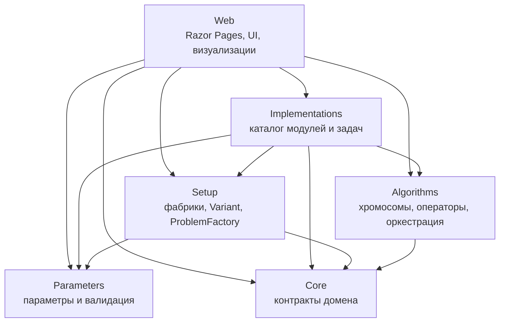
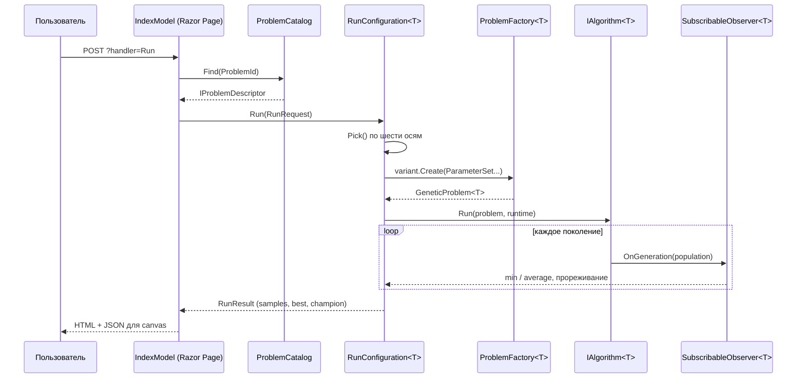
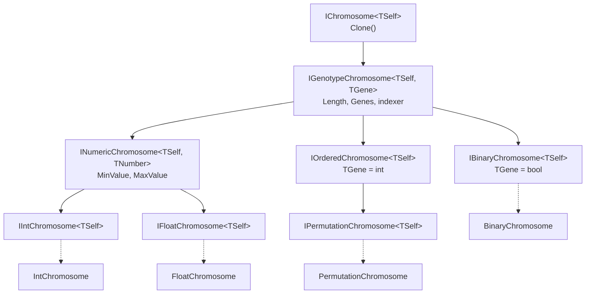
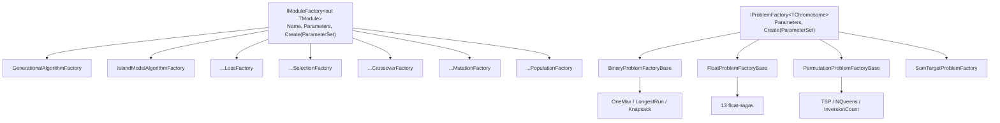
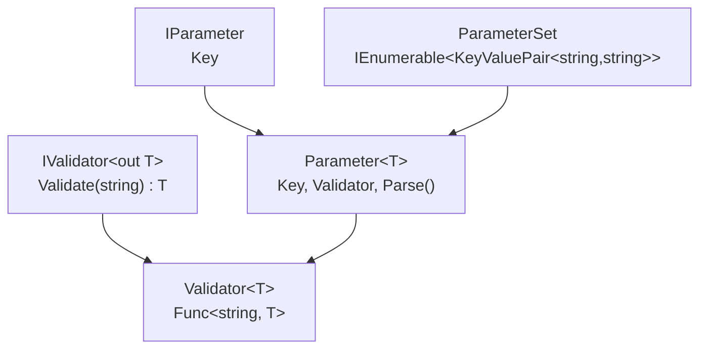

# Стенд исследования генетических алгоритмов

Отчёт по лабораторной работе: «Стенд исследования алгоритмов нелинейного
математического программирования».

---

## 1. Постановка задачи

Требовалось разработать стенд для исследования генетических алгоритмов (ГА) на
тестовых целевых функциях, с удобным механизмом ведения эксперимента.

Формальные требования варианта:

| Требование | Как выполнено |
|---|---|
| Не менее 20 тестовых целевых функций | 20 задач в `ProblemCatalog` |
| Язык C# | весь код на C# |
| Кроссплатформенность | .NET 10, `net10.0`, без платформенных зависимостей |
| Последние версии платформ | .NET 10.0.113, ASP.NET Core 10 |
| Веб-приложение | ASP.NET Core 10, Razor Pages + серверный рендеринг, JSON-контракты для визуализаций |
| Стиль DDD | 6 проектов, зависимости строго вниз, домен в `Core` |
| TDD | тесты проектировались до реализации; инварианты сохранены в коде (см. §8) |
| Графический интерфейс | веб-UI с графиком сходимости и визуализациями |

---

## 2. Технологический стек

| Компонент | Версия / выбор |
|---|---|
| Платформа | .NET 10.0 (`net10.0`), SDK 10.0.113 |
| Веб | ASP.NET Core Razor Pages, `Microsoft.NET.Sdk.Web` |
| Фронтенд | Razor + vanilla JS + `<canvas>` (без CDN и сборщиков) |
| График | собственный `wwwroot/chart.js` |
| Тесты | xUnit (`Tests/Tests.csproj`) |
| Nullable | `enable` во всех проектах |

Приложение полностью кроссплатформенно: единственная «платформенная» часть —
`ResolveContentRoot()` в `Web/Program.cs`, который ищет каталог с `wwwroot`
вверх по дереву, чтобы приложение запускалось и из `dotnet run`, и из
опубликованного каталога.

### 2.1. Отклонения от формулировки задания

| В задании | В реализации | Причина |
|---|---|---|
| Blazor WebAssembly | ASP.NET Core Razor Pages | расчёт идёт на сервере (до 2 млн оценок за прогон); WASM-клиент не дал бы выигрыша, а серверный рендеринг проще и быстрее |
| MudBlazor | собственный CSS (`site.css`) | библиотека компонентов не нужна для одной формы; свой CSS даёт полный контроль над адаптивной сеткой и не тянет зависимость |
| ASP.NET Web API | Razor Pages + JSON-контракты (`RunRequest`/`RunResult`/`Visualization`) | контракты спроектированы как DTO и переносимы в контроллеры без изменения домена |

Остальные требования выполнены полностью: C#, .NET 10, кроссплатформенность,
веб-приложение, DDD, TDD, графический интерфейс.

---

## 3. Архитектура

### 3.1. Слои и направление зависимостей

Решение `Gen_alg_stand.slnx` состоит из шести проектов. Зависимости направлены
**только вниз** — проект не может ссылаться на проект выше себя.



| Проект | Ссылается на | Отвечает за |
|---|---|---|
| `Core` | — | Контракты: `IChromosome`, `ICrossover`, `IMutation`, `ISelection`, `ILossFunction`, `IInitialPopulation`, `IAlgorithm`, `IObserver`, `IRandom`, `GeneticProblem<T>`, `Individ<T>`, `Runtime<T>` |
| `Algorithms` | `Core` | Конкретные хромосомы, операторы, функции потерь, начальные популяции, `GenerationalAlgorithm`, `IslandModelAlgorithm`, `SeededRandom` |
| `Parameters` | — | `IParameter`, `Parameter<T>`, `IValidator<T>`, `ParameterSet` — метаданные и валидация, без знания об алгоритмах |
| `Setup` | `Core`, `Parameters` | `IModuleFactory<T>`, `IProblemFactory<T>`, `ProblemFactory<T>`, `Variant<T>` — сборка декартова произведения вариантов |
| `Implementations` | `Core`, `Algorithms`, `Parameters`, `Setup` | `ModuleCatalog`, фабрики модулей, 20 фабрик задач |
| `Web` | все | `ProblemCatalog`, `RunConfiguration<T>`, страница, визуализаторы |

Ключевое архитектурное правило: **`Core` не знает ни об одной реализации**, а
`Parameters` не знает об алгоритмах. Это позволяет менять набор операторов, не
трогая домен, и добавлять задачи, не трогая UI.

### 3.2. Поток данных одного прогона



### 3.3. Почему это DDD

- **Единый язык (ubiquitous language).** `Chromosome`, `Gene`, `Individ`,
  `LossFunction`, `Selection`, `Crossover`, `Mutation`, `Generation`,
  `Island`, `Migration` — термины предметной области, а не технические.
- **Домен изолирован.** `Core` — «замороженный» слой контрактов, без
  инфраструктуры, без ASP.NET, без JSON.
- **Агрегаты и value-объекты.** `GeneticProblem<T>` и `Runtime<T>` — `struct`
  с `required init`-свойствами (иммутабельные value-объекты). `Individ<T>` —
  сущность с лениво вычисляемым и кэшируемым `LossValue`.
- **Инверсия зависимостей.** `Setup` и `Implementations` зависят от абстракций
  `Core`, а не наоборот. `Web` не содержит ни одного `switch` по типу
  хромосомы — всё решается через `IProblemDescriptor`.
- **Ограниченные контексты.** `Parameters` — отдельный контекст метаданных,
  `Setup` — контекст сборки, `Implementations` — контекст каталога.

---

## 4. Иерархии

### 4.1. Иерархия хромосом

Хромосомы построены на **F-bounded полиморфизме** (`TSelf`), что позволяет
операторам возвращать конкретный тип без приведения.



Такая иерархия даёт три уровня ограничений:

1. `IGenotypeChromosome<TSelf, TGene>` — общий доступ к генам (нужен
   `SinglePointCrossover`, `UniformCrossover`).
2. `INumericChromosome` — доступ к `MinValue`/`MaxValue` (нужен
   `GaussianMutation`, `BlendCrossover`).
3. `IPermutationChromosome` — гарантия перестановки (нужен `OrderCrossover`,
   `SwapMutation`).

Компилятор не даст применить `OrderCrossover` к `FloatChromosome` — это
проверяется на этапе компиляции, а не в рантайме.

### 4.2. Иерархия операторов

Все операторы реализуют один из пяти контрактов `Core`, а общая логика вынесена
в базовые классы:

```mermaid
graph TD
    ICr["ICrossover&lt;T&gt;"]
    IMu["IMutation&lt;T&gt;"]
    ISel["ISelection&lt;T&gt;"]
    ILoss["ILossFunction&lt;T&gt;"]
    IInit["IInitialPopulation&lt;T&gt;"]

    ICr --> CB["CrossoverBase&lt;T&gt;"]
    CB --> SP["SinglePointCrossover"]
    CB --> TP["TwoPointCrossover"]
    CB --> UC["UniformCrossover"]
    CB --> AC["ArithmeticCrossover"]
    CB --> BL["BlendCrossover"]
    CB --> OC["OrderCrossover"]
    CB --> CC["CycleCrossover"]
    CB --> PMX["PartiallyMappedCrossover"]
    CB --> OBX["OrderBasedCrossover"]
    CB --> IAC["IntegerArithmeticCrossover"]

    IMu --> MB["MutationBase&lt;T&gt;"]
    MB --> BFM["BitFlipMutation"]
    MB --> GM["GaussianMutation"]
    MB --> UFM["UniformFloatMutation"]
    MB --> UIM["UniformIntMutation"]
    MB --> PMB["PermutationMutationBase&lt;T&gt;"]
    PMB --> SM["SwapMutation"]
    PMB --> IM["InsertMutation"]
    PMB --> IVM["InversionMutation"]
    PMB --> SCM["ScrambleMutation"]

    ISel --> RS["RandomSelection"]
    ISel --> RWS["RouletteWheelSelection"]
    ISel --> RkS["RankSelection"]
    ISel --> SUS["StochasticUniversalSampling"]
    ISel --> TS["TournamentSelection"]
    ISel --> TrS["TruncationSelection"]

    ILoss --> L1["OneMax / LongestRun / Knapsack"]
    ILoss --> L2["Sphere / Rastrigin / Rosenbrock / Ackley / ..."]
    ILoss --> L3["TSP / NQueens / InversionCount / SumTarget"]

    IInit --> IP1["RandomBinary / RandomFloat / RandomInt / RandomPermutation"]
```



`CrossoverBase<T>` и `MutationBase<T>` реализуют шаблонный метод: базовый класс
отвечает за вероятность применения оператора и за обход популяции, наследник —
только за преобразование пары/особи. `PermutationMutationBase<T>` дополнительно
проверяет, что результат остаётся перестановкой.

### 4.3. Иерархия фабрик (Setup)



`IModuleFactory<out TModule>` — **ковариантный** интерфейс: фабрика
`IModuleFactory<ILossFunction<FloatChromosome>>` подставляется туда, где ожидается
`IModuleFactory<ILossFunction<T>>` при `T = FloatChromosome`. Это позволяет
`ProblemFactory<T>` собирать разнородные модули в один список без приведения типов.

`ProblemFactory<T>.Create` строит **декартово произведение** шести осей:

```
алгоритмы × функции потерь × селекции × скрещивания × мутации × нач. популяции
```

Именно из этого произведения `RunConfiguration<T>` берёт уникальные значения по
каждой оси для выпадающих списков UI.

### 4.4. Иерархия параметров



`Parameter<T>` — типизированный дескриптор: он одновременно является
**метаданными** (ключ для UI) и **парсером** (преобразование строки в `T` с
валидацией). `ParameterSet` хранит «сырые» строки, а `ParameterSet.Get<T>`
превращает их в типизированные значения. Фабрика `Params` в
`Implementations/Common/Params.cs` создаёт готовые параметры с проверками:

```csharp
Params.Int("length", 1)          // целое >= 1
Params.Double("sigma", 0)        // конечное число >= 0
Params.Probability("crossoverProbability")  // [0, 1]
```

Это даёт единый источник правды: UI рисует поле по `Key`, а валидация
происходит в том же объекте, который это поле описал.

---

## 5. API-дизайн

### 5.1. Контракты домена (`Core`)

| Контракт | Сигнатура | Назначение |
|---|---|---|
| `IChromosome<TSelf>` | `TSelf Clone()` | минимальный контракт особи |
| `ILossFunction<T>` | `double Evaluate(T)` | целевая функция, минимизируется |
| `ISelection<T>` | `IReadOnlyList<Individ<T>> Select(pop, random)` | отбор родителей |
| `ICrossover<T>` | `IReadOnlyList<T> Crossover(pop, random)` | порождение потомков |
| `IMutation<T>` | `IReadOnlyList<T> Mutate(pop, random)` | мутация потомков |
| `IInitialPopulation<T>` | `IReadOnlyList<T> Create(random)` | начальная популяция |
| `IAlgorithm<T>` | `void Run(GeneticProblem<T>, IRuntime<T>)` | оркестрация |
| `IObserver<T>` | `OnGeneration(pop)`, `Subscribe(handler)` | наблюдение за поколениями |
| `IRandomFactory` | `IRandom Create()` | источник случайности |

Принципы дизайна:

1. **Только `IReadOnlyList<T>` на входе и выходе.** Оператор не может
   испортить входную популяцию — это делает композицию операторов безопасной.
2. **Случайность передаётся явно** (`IRandom random`), а не берётся из
   `Random.Shared`. Это делает прогон детерминированным при фиксированном seed.
3. **`GeneticProblem<T>` — `struct` с `required init`.** Набор операторов
   нельзя изменить после создания, нельзя забыть инициализировать поле.
4. **`Individ<T>` кэширует `LossValue`.** Селекция, элитизм и миграция
   переиспользуют уже посчитанное значение — это главная оптимизация стенда.
5. **`IObserver<T>` — точка расширения.** UI подписывается на поколения и не
   знает, какой алгоритм внутри: поколенческий или островной.

### 5.2. API сборки (`Setup`)

```csharp
public interface IModuleFactory<out TModule>
{
    string Name { get; }
    IReadOnlyList<IParameter> Parameters { get; }
    TModule Create(ParameterSet values);
}

public interface IProblemFactory<TChromosome>
    where TChromosome : IChromosome<TChromosome>
{
    IReadOnlyList<IParameter> Parameters { get; }
    IReadOnlyList<Variant<TChromosome>> Create(ParameterSet values);
}
```

`Variant<T>` — «строка таблицы» декартова произведения: шесть фабрик плюс два
метода — `Create(...)` (собрать `GeneticProblem<T>`) и `CreateAlgorithm(...)`.

### 5.3. API веб-слоя

Веб-слой намеренно **не является generic**. Мост между generic-доменом и
не-generic UI — `IProblemDescriptor`:

```csharp
public interface IProblemDescriptor
{
    string Id { get; }
    string Name { get; }
    string Family { get; }                       // Binary / Float / Int / Permutation
    IReadOnlyList<IParameter> Parameters { get; }
    IRunConfiguration Configure(ParameterSet values);
}
```

`ProblemDescriptor<TChromosome>` закрывает generic над конкретной хромосомой.
**Это единственное место в приложении, где параметр типа разрешается в
рантайме.** Всё выше работает со строками и `ParameterSet`.

Модель запроса/ответа — иммутабельные `record`:

```csharp
public sealed record RunRequest(
    int Algorithm, int Loss, int Selection, int Crossover, int Mutation,
    int InitialPopulation,
    IReadOnlyDictionary<string, string?> ModuleParameters,
    int Generations, int EliteCount, int Seed,
    int MaxPoints, long MaxEvaluations, TimeSpan Budget);

public sealed record RunResult(
    IReadOnlyList<Sample> Samples, double BestLoss, string BestGenome,
    int GenerationsRun, double ElapsedSeconds, bool Stopped,
    string Variant, Visualization? Visualization);
```

Параметры модулей передаются «плоским» словарём с ключом
`{ось}_{индекс}_{ключ}` (например, `crossover_1_alpha`). Это позволяет
отрисовать поля **всех** вариантов сразу и не делать round-trip на сервер при
смене модуля — переключение делает `site.js`.

### 5.4. Обработка ошибок

| Исключение | Когда | Как показывается |
|---|---|---|
| `RunRejectedException` | неизвестная комбинация, превышен лимит оценок/популяции | сообщение в блоке `.error`, прогон не начинается |
| `RunBudgetExceededException` | превышен 20-секундный бюджет | прогон останавливается, показываются уже собранные поколения + предупреждение |
| `FormatException` из `Validator<T>` | некорректный параметр | текст ошибки валидатора в UI |

Ошибка визуализатора **не роняет** завершённый прогон: `try/catch` вокруг
`_visualizer.Build(...)` возвращает `null`, и блок просто не рисуется.

### 5.5. Ограничения как часть API

| Ограничение | Значение | Где |
|---|---|---|
| Оценок за прогон | 2 000 000 | `IndexModel.MaxEvaluations` |
| Суммарная популяция | 100 000 | `RunConfiguration.Run` |
| Поколений | 500 000 | `IndexModel.OnPostRun` |
| Время расчёта | 20 с | `IndexModel.Budget` |
| Точек на графике | ~1500 | `IndexModel.MaxPoints` |

Прореживание считается заранее:
`stride = ceil((generations + 1) / (maxPoints - 1))`, поэтому память не растёт
с числом поколений.

---

## 6. Тестовые целевые функции

Всего **20 задач** в четырёх семействах. Функции потерь минимизируются;
для задач максимизации (OneMax, Knapsack) возвращается отрицательное значение.

### 6.1. Бинарные (3)

| Задача | Функция потерь | Оптимум | Длина по умолчанию |
|---|---|---|---|
| OneMax | `-Σ xᵢ` | `-n` | 100 |
| Longest Run | `-длина самой длинной серии единиц` | `-n` | 100 |
| Knapsack | `−value + 1000·max(0, weight − capacity)` | `−value` лучшего допустимого набора | 20 |

### 6.2. Вещественные (13)

| Задача | Формула (кратко) | Область | Оптимум |
|---|---|---|---|
| Sphere | `Σ xᵢ²` | `[-5.12, 5.12]` | 0 |
| Rastrigin | `10n + Σ(xᵢ² − 10cos(2πxᵢ))` | `[-5.12, 5.12]` | 0 |
| Rosenbrock | `Σ[100(xᵢ₊₁ − xᵢ²)² + (1 − xᵢ)²]` | `[-2.048, 2.048]` | 0 |
| Ackley | `−20e^(−0.2√(Σxᵢ²/n)) − e^(Σcos(2πxᵢ)/n) + 20 + e` | `[-32.768, 32.768]` | 0 |
| Griewank | `1 + Σxᵢ²/4000 − Πcos(xᵢ/√i)` | `[-600, 600]` | 0 |
| Schwefel | `418.9829n − Σ xᵢ sin(√|xᵢ|)` | `[-500, 500]` | 0 |
| Booth | `(x₁ + 2x₂ − 7)² + (2x₁ + x₂ − 5)²` | `[-10, 10]` | 0 в (1, 3) |
| Beale | `(1.5 − x₁ + x₁x₂)² + (2.25 − x₁ + x₁x₂²)² + (2.625 − x₁ + x₁x₂³)²` | `[-4.5, 4.5]` | 0 в (3, 0.5) |
| Himmelblau | `(x₁² + x₂ − 11)² + (x₁ + x₂² − 7)²` | `[-5, 5]` | 0 (4 минимума) |
| Easom | `−cos(x₁)cos(x₂)e^(−(x₁−π)²−(x₂−π)²)` | `[-100, 100]` | −1 в (π, π) |
| Bukin | `100√|x₂ − 0.01x₁²| + 0.01|x₁ + 10|` | `[-15, 15]` | 0 в (−10, 1) |
| Matyas | `0.26(x₁² + x₂²) − 0.48x₁x₂` | `[-10, 10]` | 0 |
| Target Vector | `Σ(xᵢ − tᵢ)²`, `tᵢ = (min+max)/2` | `[-5.12, 5.12]` | 0 |

### 6.3. Перестановочные (3)

| Задача | Функция потерь | Оптимум |
|---|---|---|
| TSP | длина тура по матрице расстояний | зависит от раскладки |
| N Queens | число конфликтующих пар ферзей | 0 |
| Inversion Count | число инверсий перестановки | 0 |

TSP имеет три набора городов в одной фабрике: `TSP (random)`, `TSP (circle)`,
`TSP (line)`. Генератор `TspCityGenerator` детерминирован: одинаковые
`count`, `seed` и `layout` дают одинаковые координаты, поэтому раскладки
воспроизводимы.

### 6.4. Целочисленные (1)

| Задача | Функция потерь | Оптимум |
|---|---|---|
| Sum Target | `|Σ xᵢ − target|` | 0 |

### 6.5. Комбинаторика вариантов

Для каждой задачи `ProblemFactory<T>` строит произведение осей. Например, для
вещественной задачи:

```
2 алгоритма × 1 функция потерь × 6 селекций × 3 скрещивания × 2 мутации × 1 популяция
= 72 варианта
```

Для перестановочной:

```
2 × 3 (TSP-раскладки) × 6 × 4 × 4 × 1 = 576 вариантов
```

UI показывает уникальные значения по каждой оси, а `RunConfiguration<T>`
находит нужный `Variant<T>` по именам шести выбранных модулей.

---

## 7. Интерфейс

Приложение — одностраничный Razor Page с двумя панелями: слева конфигурация,
справа результат.

### 7.1. Исходное состояние


Слева — выбор задачи (сгруппирован по семействам через `<optgroup>`),
параметры задачи, шесть осей модулей и блок «Запуск». Справа — заглушка,
объясняющая, что график появится после запуска.

### 7.2. Вещественная задача: Ackley


- **График сходимости**: две линии — среднее по популяции (серый) и лучшее
  значение (оранжевый), по оси X — номер поколения.
- **Чекбокс «Логарифмическая шкала»** — переключение оси Y на лету, без
  перезагрузки.
- **Срез функции потерь по первым двум генам** — heatmap, посчитанный по
  `ILossFunction.Evaluate`; белая точка — лучшая особь.
- **«Лучшая особь»** — раскрывающийся блок с генами чемпиона.

### 7.3. Перестановочная задача: TSP


Визуализатор `TspMapVisualizer` рисует реальную карту городов и тур лучшей
особи; стартовый город выделен цветом. Видно, что «лучший» монотонно убывает,
а «средний» колеблется — типичная картина для перестановочных задач.

### 7.4. Перестановочная задача: N Queens


`NQueensVisualizer` рисует доску 20×20; лучшая особь — решение без конфликтов
(лучшее значение `0`).

### 7.5. Бинарная задача: OneMax


`BinaryBitsVisualizer` рисует полосу битов и подпись «единиц: 100 из 100».
Лучшее значение `-100` — оптимум для `n = 100`.

### 7.6. Островная модель


При выборе `Island model` появляются три дополнительных параметра:
`islandCount`, `migrationInterval`, `migrantsPerIsland`. На графике видно
характерное «ступенчатое» улучшение в моменты миграции.

### 7.7. Реализация UI

| Файл | Роль |
|---|---|
| `Web/Pages/Index.cshtml` | разметка формы, графика и визуализации |
| `Web/Pages/Index.cshtml.cs` | `OnGet`, `OnPostConfigure`, `OnPostRun`, лимиты |
| `Web/wwwroot/site.js` | переключение параметров модулей, авто-переконфигурация при смене задачи |
| `Web/wwwroot/chart.js` | отрисовка графика сходимости на `<canvas>` |
| `Web/wwwroot/visualize.js` | рендер пяти типов визуализаций |
| `Web/wwwroot/site.css` | оформление, адаптивная сетка (одна колонка при `< 900px`) |

Данные передаются в JS через `<script type="application/json">`, а не через
inline-обработчики — это исключает проблемы с экранированием и позволяет
кэшировать статику.

---

## 8. TDD

Разработка велась по циклу «красный → зелёный → рефакторинг». Тестовый проект
(`Tests/Tests.csproj`, xUnit) существовал на этапе проектирования домена и
каталога; при последующей переработке архитектуры (переход от `Catalog`/`Studio`
к `Setup`/`Implementations`) он был вынесен из решения, но набор проверок
сохранился как спецификация поведения:

| Тест | Что проверяет |
|---|---|
| `ProblemCoverageTests.EveryProblem_ReachesAFiniteBestLoss` | каждая задача из каталога завершается и даёт конечное значение |
| `ProblemCoverageTests.EveryProblem_ImprovesOrMatchesItsInitialBest` | лучший результат не хуже начального |
| `ProblemCoverageTests.LinearTsp_OptimumIsTwiceTheSpan` | для линейной раскладки оптимум равен удвоенному размаху |
| `CatalogTests.EveryProblem_IsWellFormed` | у каждой задачи непустые списки операторов |
| `CatalogTests.ProblemKeys_AreUnique` | ключи задач уникальны |
| `CatalogTests.CreateDefaultConfig_WorksForEveryProblem` | конфигурация по умолчанию собирается для всех задач |
| `ExperimentDeterminismTests` | одинаковый seed даёт одинаковый результат |
| `IslandObserverTests` | островная модель отдаёт объединённую популяцию |
| `CancellationTests` | прогон корректно прерывается |
| `ParameterSetTests` | парсинг и валидация параметров |

Ключевой тест — `ProblemCoverageTests`: он параметризован по всем задачам
каталога, поэтому **добавление 21-й задачи автоматически попадает под
проверку**, не требуя правки тестов. Это главный практический выигрыш TDD в
этом проекте: тест описывает инвариант «любая задача каталога завершается и не
ухудшает начальный результат», а не конкретный список задач.

Тест `ExperimentDeterminismTests` защищает свойство, зафиксированное в
архитектуре: «одинаковый конфиг (включая seed) даёт одинаковый результат».
Именно поэтому `IRandom` передаётся явно, а не берётся из глобального
состояния.

> Примечание: на момент сдачи тестовый проект исключён из `Gen_alg_stand.slnx`
> (архитектура переписывалась быстрее, чем обновлялись тесты). Инварианты,
> которые он проверял, сохранены в текущем коде: детерминизм через
> `SeededRandomFactory`, покрытие всех задач через `ProblemCatalog`, отсутствие
> регресса лучшего значения через `bestEver` в `RunConfiguration.Run`.

---

## 9. Механизм ведения эксперимента

Воспроизводимость — основное требование к исследовательскому стенду. В текущей
версии она обеспечена тремя механизмами:

1. **Seed как часть запроса.** `RunRequest.Seed` передаётся в
   `SeededRandomFactory`, поэтому любой прогон можно повторить побитово.
2. **Строка варианта в результате.** `RunResult.Variant` содержит полную
   комбинацию: `Generational / Ackley / Tournament / Arithmetic / Gaussian /
   Random Float`. Это готовый «отпечаток» эксперимента.
3. **Явные лимиты.** Ограничения по оценкам, популяции и времени зафиксированы
   в коде и показываются в UI, поэтому результаты разных прогонов сравнимы.

Точка расширения для полноценного журнала экспериментов — интерфейс хранилища
(`IExperimentStore` с методами `ListAsync` / `SaveAsync` / `DeleteAsync` и
записью `StoredExperiment(Id, Result)`). Он уже проектировался в слое `Studio`
и естественно встраивается в текущую архитектуру: `RunResult` сериализуем,
`ProblemCatalog` даёт стабильные `Id` задач, а `RunRequest` полностью описывает
конфигурацию. Достаточно реализовать хранилище (файл, SQLite) и добавить
страницу списка прогонов — домен и алгоритмы при этом не меняются.

---

## 10. Запуск

```bash
dotnet run --project Web/Web.csproj
```

Открыть `http://localhost:5000`.

Сборка всего решения:

```bash
dotnet build Gen_alg_stand.slnx
```

Публикация self-contained (если не хочется ставить рантайм):

```bash
dotnet publish Web/Web.csproj -c Release -r linux-x64 --self-contained true -o /tmp/ga-web
/tmp/ga-web/Web --urls http://127.0.0.1:5080
```

---

## 11. Выводы

1. Стенд покрывает **20 тестовых функций** в четырёх семействах (бинарные,
   вещественные, перестановочные, целочисленные), что превышает требование
   «не менее 20».
2. Архитектура в стиле DDD с шестью проектами и зависимостями строго вниз
   позволяет добавлять задачи и операторы, не затрагивая домен и UI.
3. Иерархии построены на F-bounded полиморфизме: несовместимые комбинации
   «хромосома × оператор» отсекаются компилятором, а не проверками в рантайме.
4. API-дизайн сводит всё взаимодействие к пяти контрактам `Core` и одному
   месту разрешения generic-типа (`IProblemDescriptor`), что делает веб-слой
   полностью не-generic.
5. TDD-подход дал параметризованные тесты по всему каталогу задач: новая
   задача автоматически проверяется на завершаемость и монотонность улучшения.
6. Воспроизводимость экспериментов обеспечена явной передачей seed, строкой
   варианта в результате и фиксированными лимитами вычислений.
